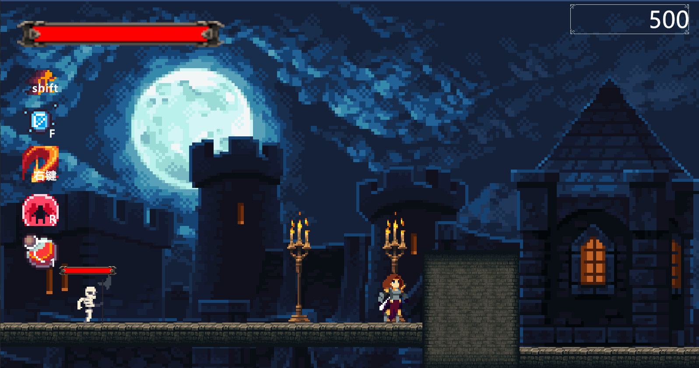
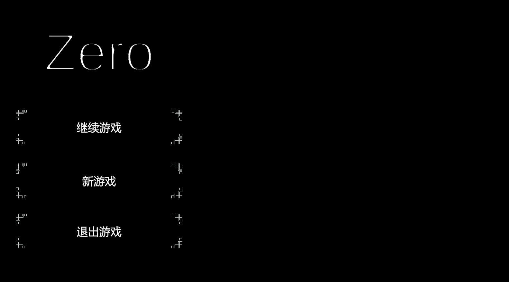
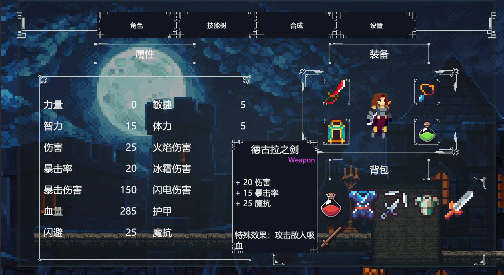
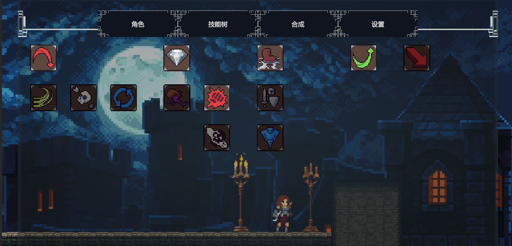
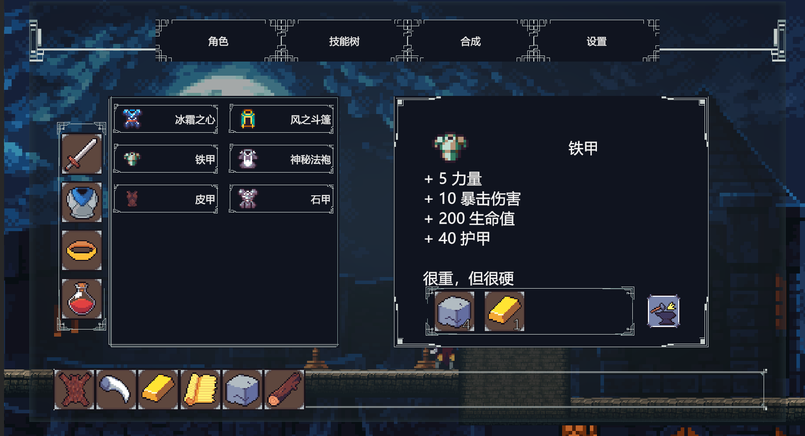
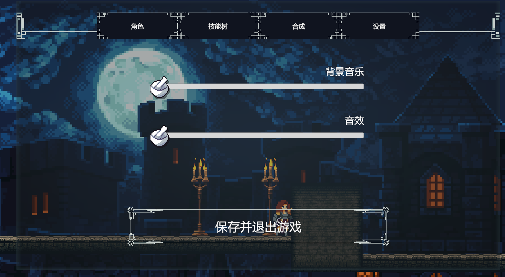
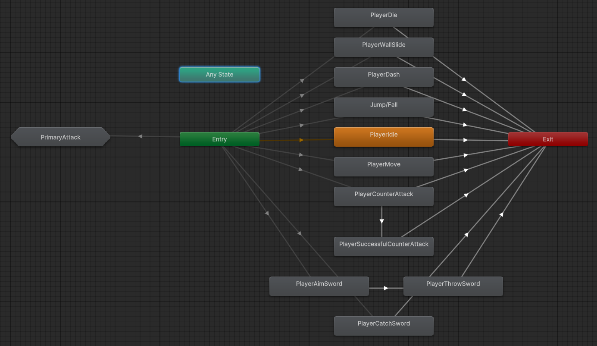
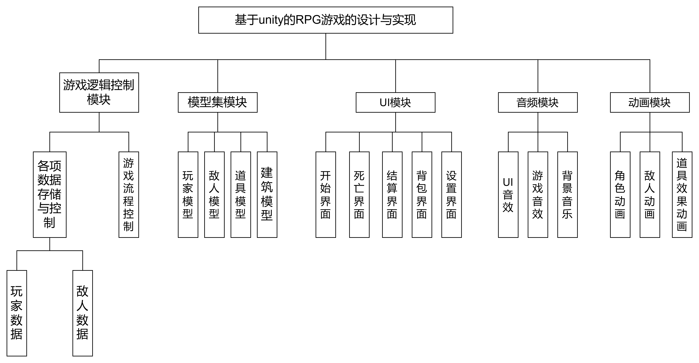

# RPG Zero (Zero) ⚔️

<p align="center">
  
  
  
  
  
</p>

<p align="center">
  
</p>

> **RPG Zero** 是一款基于 **Unity 6** 引擎与 **C#** 开发的 2D 横版类银河恶魔城动作角色扮演游戏（2D Metroidvania Action RPG）。
> 游戏融合了平台跳跃、连招动作战斗、元素异常机制、自由技能树构建以及装备锻造系统。核心遵循 **“探索（Explore） - 锁机制（Lock） - 角色提升（Character）”** 的正反馈闭环设计，带来爽快的打击感与深度的养成体验。

---

## 📸 游戏截图预览 (Screenshots)

<table align="center">
  <tr>
    <td align="center" width="50%">
      <br />
      <b>游戏主菜单 (Title Menu)</b>
    </td>
    <td align="center" width="50%">
      <br />
      <b>战斗主场景与 HUD (Gameplay)</b>
    </td>
  </tr>
  <tr>
    <td align="center" width="50%">
      <br />
      <b>角色面板与装备属性 (Character & Inventory)</b>
    </td>
    <td align="center" width="50%">
      <br />
      <b>技能树系统 (Skill Tree)</b>
    </td>
  </tr>
  <tr>
    <td align="center" width="50%">
      <br />
      <b>材料合成与装备打造 (Crafting System)</b>
    </td>
    <td align="center" width="50%">
      <br />
      <b>系统设置与音量调节 (Settings Menu)</b>
    </td>
  </tr>
</table>

---

## 🌟 核心特色与玩法系统

### 1. ⚔️ 动作与战斗机制（有限状态机 FSM）
- **灵活的移动机制**：支持奔跑、跳跃、二段跳、空中冲刺（Dash）、蹬墙跳（Wall Jump）与滑墙下落。
- **丰富的战斗招式**：
  - **三段普通攻击连击**：平滑衔接的动画混合与受击判定。
  - **格挡与弹反反击（Counter Attack）**：在精准时机格挡敌人攻击触发高额反击。
  - **飞剑系统（Sword Throw & Recall）**：支持瞄准射出飞剑穿透/钉刺敌人，并随时召唤回收。
  - **终极技能**：包括克隆残影打击、时空黑洞吸收与引爆、魔法水晶共鸣。

<p align="center">
  <br />
  <em>玩家分层动画状态机 (Player Animator FSM)</em>
</p>

### 2. 🌲 技能树与属性成长
- **技能树系统**：消耗在冒险中获得的金币逐步点亮专属技能树分支，解锁主动技能与强化被动。
- **多元角色属性**：
  - **基础属性**：力量、敏捷、智力、体力。
  - **衍生战斗属性**：物理伤害、暴击率、暴击伤害、生命上限、护甲、闪避率、魔法抗性。
- **元素异常状态**：
  - 🔥 **点燃（Ignite）**：持续造成真实火焰伤害。
  - ❄️ **冰冻（Chill / Freeze）**：大幅降低移动与攻击速度，冻结强敌。
  - ⚡ **感电（Shock）**：在受击时向周围敌人释放连锁闪电。

### 3. 🎒 装备锻造与物品背包
- **材料搜集与自由打造**：击败怪物掉落骨头、兽皮、石块、丝绸、金块、木材等基础素材，可在合成面板打造专属神兵。
- **丰富装备库**：
  - **武器**：如【德古拉之剑】（攻击吸血）、【冰与火之剑】（释放双重剑气）、【雷之呼吸】（雷电附魔）等。
  - **防具**：如【冰霜之心】（低血冻结敌人）、【风之斗篷】（提高极限闪避）、【神秘法袍】、【精钢重甲】等。
  - **饰品与药剂**：各类元素护符、吸血项链、坚固/暴烈药水等。

### 4. 👾 智能敌人 AI 与 BOSS 战
- **分层状态机控制**：基于射线探测与动态感知，敌人具备巡逻、索敌追击、攻击冷却计算、受击僵直等完整行为逻辑。
- **多样化怪物类型**：
  - **骷髅兵（Skeleton）**：基础近战，高警惕度。
  - **史莱姆（Slime）**：具有黏性分裂机制，阵亡后分裂成数个小型史莱姆。
  - **暗影弓箭手（Archer）**：远程射击与拉扯跑位。
  - **自爆幽影（Shady）**：接近玩家时启动蓄力自爆，造成范围毁灭伤害。
  - **终极领主 BOSS**：拥有多阶段战斗技能循环与高额生命护甲。

### 5. 💾 数据持久化与系统架构
- **解耦架构**：采用 **MVC 思想**，将游戏逻辑控制器、UI 表现层与 ScriptableObject 模型集完全解耦。
- **JSON 档案持久化**：基于 `SaveManager` 与 `DataHandler`，利用 `FileStream` 自动序列化玩家属性、金币、当前穿戴装备、背包物品及技能树进度，保障多场景存档与续关。
- **音频对象池**：自建 `AudioManager` 音频播放池，独立隔离 BGM 与 SFX，通过随机音高调制（Pitch Modulation）显著增强打击节奏感。

<p align="center">
  <br />
  <em>系统功能结构与模块划分 (System Architecture)</em>
</p>

---

## 🎮 操作指南 (Controls)

| 按键 / 操作 | 动作说明 |
| :--- | :--- |
| <kbd>W</kbd> <kbd>A</kbd> <kbd>S</kbd> <kbd>D</kbd> / 方向键 | 角色移动 / 滑墙 / 爬梯 |
| <kbd>Space</kbd> | 跳跃 / 蹬墙跳 |
| <kbd>Left Shift</kbd> | 快速冲刺 (Dash) |
| <kbd>鼠标左键</kbd> | 普通攻击（三段连招） |
| <kbd>鼠标右键</kbd> | 瞄准并投掷飞剑 / 召回飞剑 |
| <kbd>Q</kbd> | 格挡反击 (Counter Attack) |
| <kbd>F</kbd> / <kbd>R</kbd> | 施放已装备的高阶主动技能（黑洞 / 水晶） |
| <kbd>C</kbd> | 打开 / 关闭 角色属性与装备背包面板 |
| <kbd>V</kbd> | 打开 / 关闭 技能树面板 |
| <kbd>B</kbd> | 打开 / 关闭 锻造合成面板 |
| <kbd>ESC</kbd> | 呼出系统设置菜单 / 暂停游戏 |

---

## 🛠️ 技术选型与项目结构

- **开发引擎**：Unity 6000 (Unity 6 / 2022.3 LTS 兼容)
- **脚本语言**：C# (.NET Standard 2.1)
- **渲染管线**：Universal Render Pipeline (URP 2D)
- **设计模式**：单例模式 (Singleton)、有限状态机 (FSM)、观察者/事件委托委托 (Delegate & Event)、对象池 (Object Pool)

### 目录结构概览
```
RPG zero/
├── Assets/
│   ├── Animator/         # 角色与敌人的分层动画机与状态切换动画
│   ├── Audio/            # 背景音乐与战斗音效资源
│   ├── Data/             # 物品、装备、技能相关的 ScriptableObject 数据配置
│   ├── Graphics/         # 像素精灵图、图标集与 2D 光照材质
│   ├── Prefabs/          # 玩家、怪物、投掷物、特效与 UI 预制体
│   ├── Scenes/           # 主菜单场景与游戏关卡主场景
│   ├── Settings/         # URP 2D 渲染配置与全局图形参数
│   └── script/           # 核心代码逻辑
│       ├── Enemy/        # 敌人状态机与具体 AI 行为脚本
│       ├── Player/       # 玩家有限状态机、控制器与碰撞检测
│       ├── Save and Load/# JSON 数据持久化与存读档管理
│       ├── Skills/       # 技能基类与各个主动/被动技能实现
│       ├── Stats/        # 角色属性、数值计算与元素状态系统
│       └── UI/           # 背包、技能树、锻造、HUD 等界面控制器
├── Screenshots/          # README 展示与文档高清屏幕截图
├── Packages/             # Unity 官方与第三方依赖包声明
└── ProjectSettings/      # 项目物理、图层、输入与项目设置
```

---

## 🚀 快速上手与运行说明

### 环境要求
1. **Unity Editor**：推荐使用 Unity 6000 或更高版本（或 Unity 2022.3 LTS 并安装 2D URP 模块）。
2. **Git LFS**：本项目包含高清字体与音频资源，克隆前请务必确认本地已安装并初始化 **Git LFS**。

### 克隆与拉取
```bash
# 1. 确保已开启 Git LFS 支持
git lfs install

# 2. 克隆仓库
git clone https://github.com/QiSann/RPG-zero.git

# 3. 检查大文件是否完整拉取
cd RPG-zero
git lfs pull
```

### 打开工程
1. 启动 **Unity Hub**。
2. 点击 **Add** 按钮，选择工程根目录打开。
3. 首次加载完毕后，在 Project 视窗中导航至 `Assets/Scenes/` 目录。
4. 双击打开 `MainScene.unity`，点击 Editor 顶部的 **Play** 按钮即可畅玩体验！

---

## 📜 许可证 (License)

本项目遵循 [MIT License](LICENSE) 开源协议。所有代码与工程资产仅供个人学习、技术研究与毕业交流使用。
